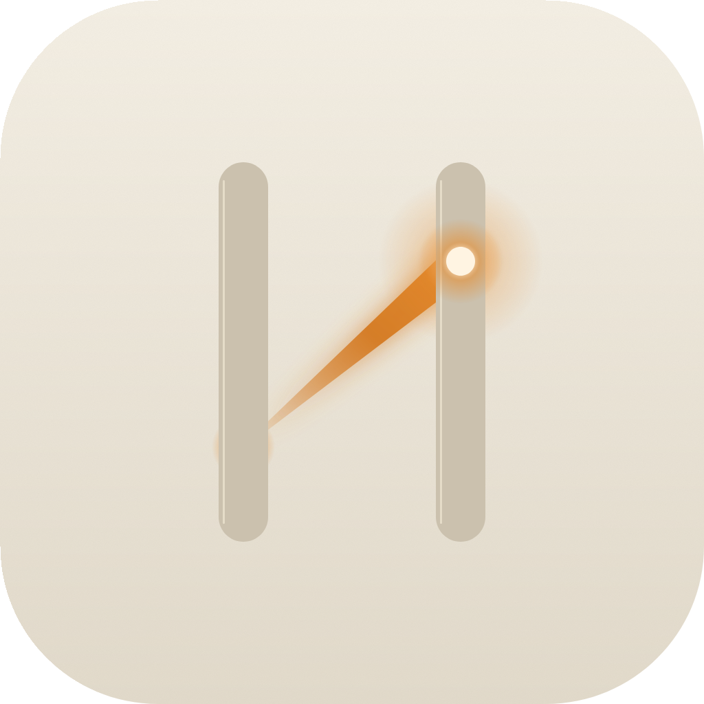

<picture>
  <source media="(prefers-color-scheme: dark)" srcset="docs/design/icon-readme-dark.png">
  
</picture>

# hugin

**Der Gedanke, der für dich ausfliegt.**

Ein KI-Datei-Agent fürs iPad — offline, privat, und nur dort, wo du es erlaubst.

---

Hugin ist der Rabe Odins, der als Gedanke umherschwirmt und zurückberichtet, was er gesehen hat. Diese App tut das für deine Dateien: Du gibst einen Auftrag — *„Fasse meine Rechnungen des Mai zusammen"* — und Hugin fliegt los, liest, findet, benennt um, schreibt. **In deinen Freigaben, unter deiner Farbe, ohne je zu löschen.**

## Was Hugin ausmacht

### 🕊️ Der Botengang — du bestimmst, wie weit er fliegt

| Modus | Bedeutung |
|---|---|
| **🏠 Im Haus** | Nur iPad — offline, privat, schnell. Keine Datei verlässt das Gerät. |
| **🌗 Nach Bedarf** | Lokal zuerst; Claude übernimmt nur, wenn ein Auftrag zu schwer wird. Jede Übergabe siehst du. |
| **☁️ Zu Claude** | Ganze Kraft für schwere Aufträge — nur die nötigen Dateien verlassen das iPad. |

### 🛤️ Die Flugbahn — jeder Schritt sichtbar

Jede Aktion landet als Knoten in der Flugbahn: `SUCHEN` · `LESEN` · `SCHREIBEN` · `ÜBERGABE` — mit Dauer, Ergebnis und **wer gedacht hat**:

| Farbe | Bedeutung |
|---|---|
| 🟠 **Glut** | lokal auf dem iPad (Foundation Models) |
| 🔵 **Frost** | Claude in der Cloud |
| ⚪ **Knochen** | Hugin wartet auf dich |

### 🧲 Das Fundstück

Während Hugin liest, sammelt er gefundene Werte — Beträge, Namen, Daten — live im Fundstück-Panel. Die Punktfarbe sagt, wer die Datei gelesen hat.

### ✊ Halten statt Klicken

Überschreiben ist kein Ein-Klick-Accident: Hugin zeigt dir den **Diff** (was geht, was kommt), legt automatisch eine **Sicherung** an — und bestätigt erst, wenn du den Knopf **1,2 Sekunden hältst**.

### 🕊️ Munin — dein zweiter Rabe

Odins zweiter Rabe ist das Gedächtnis: Jeder Auftrag landet in der Historie — mit Titel, Akteur und Zeitpunkt, jederzeit wieder einsehbar.

### 🚫 Was Hugin *nicht* tut

**Löschen. Nie.** Es gibt kein Lösch-Werkzeug, nicht in der UI, nicht in den Werkzeugen des Agenten.

## Installation (ohne Mac)

> Hugin wird nicht über den App Store vertrieben — es ist ein privates Projekt und läuft als signierte Sideload-App auf deinem eigenen iPad.

<strong>1 · Voraussetzungen</strong>

- iPad mit **iPadOS 26+** (Apple Intelligence-fähig, z. B. M1+)
- Windows-PC mit **[Sideloadly](https://sideloadly.io)** (iTunes-Treiber mitinstallieren lassen)
- Apple-ID (Gratis-Konto genügt)
- Dieses Repo wird von GitHub Actions gebaut — das fertige `.ipa` liegt unter **Actions → neuester Lauf → Artifacts → `Hugin-unsigned.ipa`**

<strong>2 · Installieren</strong>

1. `Hugin-unsigned.ipa` aus den [Actions-Artifacts](../../actions) herunterladen
2. iPad per **USB** an den PC, Sideloadly starten: IPA wählen → Apple-ID eintragen → **Install**
   *(Sideloadly ist ein Tool, das Apps ohne App-Store aufs iPad bringt — die Apple-ID braucht es nur zum Signieren auf deinem PC.)*
3. iPad: **Einstellungen → Allgemein → VPN & Geräteverwaltung** → dein Apple-ID-Profil → **Vertrauen**

<strong>3 · Erster Start</strong>

1. Start-Sequenz abwarten (1,4 s — Hugin landet)
2. **Einstellungen → Claude API-Key** eintragen (bleibt nur im iPad-Schlüsselbund) — optional, „Im Haus" läuft auch ohne
3. **Ordner freigeben** (Dateien-App: z. B. Rechnungen, Notizen) — Hugin arbeitet ausschließlich darin
4. Auftrag eintippen: *„Liste die Dateien"* — los.

> **Gratis-Apple-ID:** Die App läuft 7 Tage, dann Schritt 2 wiederholen. Deine Daten und der Munin-Verlauf bleiben erhalten.

## Architektur

| Baustein | Technologie |
|---|---|
| App | Swift 6 · SwiftUI · iPadOS 26 |
| Lokale Intelligenz | **Foundation Models** (on-device, offline, gratis) |
| Cloud-Intelligenz | **Claude API** (Anthropic Messages, Tool-Use) |
| Speicher | SwiftData (Munin-Historie) · Keychain (API-Key) |
| Dateizugriff | Security-Scoped Bookmarks — nur deine Freigaben, doppelt geprüftes Pfad-Containment |
| Build & Tests | GitHub Actions (macOS-Runner, iOS-Simulator) · XcodeGen · XCTest |

Design-System und Verhalten sind vollständig dokumentiert in [`docs/design/DESIGN-SYSTEM.md`](docs/design/DESIGN-SYSTEM.md) — Farben, Wisp-Zustände, Motion-Tokens, alle Screens.

## Roadmap

- **Phase 2 — Botengang erweitern:** App-Steuerung über App Intents (Mail, Kalender, Notizen), lange Hintergrund-Läufe
- **Phase 3 — Sehen:** ScreenCapture-Verstehen („Was ist gerade auf meinem Bildschirm?")

## Nutzung

1. **Erster Start:** Launch-Sequenz abwarten — Funke, zwei Stäbe, aufsteigende Lichtspur, Aufflammen (≈ 1,4 s) — dann landet Hugin auf dem Start-Screen „Was soll ich für dich erledigen?".
2. **Freigabe anlegen:** Seitenleiste → **Ordner freigeben**. Hugin arbeitet ausschließlich in deinen Freigaben — und löscht niemals etwas.
3. **Claude-Key (optional):** Einstellungen → **Claude API-Key** eintragen (bleibt nur im iPad-Schlüsselbund). Ohne Key läuft der Modus „Im Haus" weiter.
4. **Erster Auftrag:** z. B. *„Fasse meine Rechnungen des Mai zusammen"* — oder einfach einen der Vorschläge auf dem Start-Screen antippen.
5. **Botengang:** Stelle am Composer oder in den Einstellungen ein, wie weit Hugin fliegt — **Im Haus** (nur iPad, offline) · **Nach Bedarf** (lokal zuerst, Claude nur bei schweren Aufträgen — jede Übergabe erscheint in der Flugbahn) · **Zu Claude** (ganze Kraft, nur die nötigen Dateien verlassen das iPad).
6. **Überschreiben = Halten:** Will Hugin eine bestehende Datei ersetzen, zeigt er dir den **Diff** und legt vorher eine **Sicherung** an. Bestätigt wird erst, wenn du den Knopf **1,2 Sekunden hältst** — kein Ein-Klick-Accident.
7. **Munin-Historie:** Jeder Auftrag landet in der Seitenleiste — mit Titel und Akteur, jederzeit wieder einsehbar, auch nach Neustart.
8. **Alle 7 Tage:** Mit Gratis-Apple-ID verfällt die App nach 7 Tagen — einfach das aktuelle IPA erneut per Sideloadly installieren (Daten und Historie bleiben). Liegt dein PC nicht neben dem iPad: das IPA aus den Actions-Artifacts lässt sich auch über **Tailscale** übertragen.

### Smoke-Checkliste (nach jeder Installation)

- [ ] App startet mit der Launch-Sequenz (Funke → Stäbe → Lichtspur → Aufflammen → UI)
- [ ] Start-Screen erscheint (Wortmarke, Composer, Vorschläge)
- [ ] Ein Auftrag läuft mit sichtbarer Flugbahn (Knoten wie SUCHEN · LESEN · SCHREIBEN)
- [ ] Beim Überschreiben erscheint der Halten-Dialog (Diff + Sicherungshinweis)
- [ ] Das Fundstück-Panel zeigt gefundene Werte mit Akteur-Punkten
- [ ] „Anhalten" stoppt den laufenden Auftrag („Angehalten.")
- [ ] Der Munin-Eintrag bleibt nach App-Neustart erhalten

## FAQ

**Warum gibt es keinen App-Store-Download?** Apple erlaubt Agent-Apps mit Ordnerzugriff nicht im regulären Vertrieb für private Konten. Sideload ist der ehrliche Weg.

**Was verlässt mein iPad?** Im Modus „Im Haus": nichts. Bei Claude-Aufträgen: nur die Dateiinhalte, die nötig sind — jede Übertragung erscheint als ÜBERGABE-Knoten in deiner Flugbahn.

**Wo liegt der Claude-API-Key?** Im iOS-Schlüsselbund (`ThisDeviceOnly`) — nie im Code, nie im Repo, nie in Backups.

## Sicherheit

Damit **nichts nach draußen geht, was nicht soll**, ist mehrfach gesichert:

| Schicht | Schutz |
|---|---|
| **Push** | GitHub Secret Scanning **mit Push-Protection** — Token im Commit blockiert den Push direkt |
| **Historie** | Gitleaks scannt bei jedem Push die komplette Commit-Historie |
| **Code** | CodeQL (Swift) prüft auf injektionssichere Muster, jeden Montag + auf Push |
| **Dependencies** | Dependabot überwacht die GitHub Actions |
| **Runtime** | API-Key nur im Keychain (`ThisDeviceOnly`), keine Disk-Caches, ATS-HTTPS nur zu `api.anthropic.com` |
| **App-Verhalten** | Pfad-Containment doppelt (lexikalisch + Symlink-real), kein Lösch-Werkzeug, Überschreiben nur per Halten-Gate |

Details und Melde-Wege: [`SECURITY.md`](SECURITY.md)

## Lizenz

Code steht unter [MIT](LICENSE) · Schriftarten (Geist, Geist Mono) unter [SIL OFL 1.1](docs/design/fonts/OFL-LICENSE.txt)

---

**hugın** · Der Gedanke, der für dich ausfliegt.

*Built with Swift, Wisp-Öl und vier sehr kritischen Review-Agenten.*

